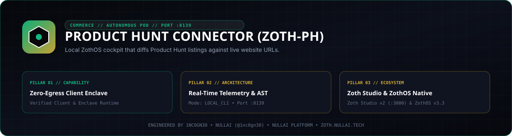

<p align="center">
  
</p>

# Product Hunt Connector (`zoth-ph`)

**Zero-dependency Python 3.10+ read-only Product Hunt GraphQL v2 client, website/GitHub URL drift auditor, badge snippet generator, and loopback cockpit.**

- **Zoth Studio v2 Dossier**: [https://zoth.nullai.tech/tools/producthunt-connector](https://zoth.nullai.tech/tools/producthunt-connector)
- **Default Loopback Endpoint**: `http://127.0.0.1:8139`
- **Runtime Dependencies**: Zero external Python runtime packages (100% Python `stdlib`)
- **License**: MIT (100% free and open-source)

---

## Overview

`producthunt-connector` (`zoth-ph`) reads live Product Hunt post metadata via GraphQL v2 (votes, weekly/monthly rank, comments, reviews, and `productLinks`), normalizes URLs (stripping `?ref=producthunt` and trailing slashes), and diffs the live listing against desired website and GitHub release URLs. Because Product Hunt developer tokens are read-only for listing links, the tool never auto-posts or mutates listings—when drift is detected, it outputs exact maker-dashboard remediation steps. Developer tokens are stored locally in `~/.config/zothos/producthunt.secret.json` with `0600` file permissions.

---

## Architecture

```text
src/producthunt_connector/
├── client.py       # Stdlib Product Hunt GraphQL v2 client, URL drift analyzer & HTML badge builder
├── config.py       # Desired-state config loader, URL normalizer & 0600 token storage (~/.config/zothos/)
├── cockpit.py      # Loopback ThreadingHTTPServer REST API + HTML cockpit (127.0.0.1:8139)
└── cli.py          # CLI entrypoint (`zoth-ph` / `producthunt-connector`)
```

---

## Quickstart

```bash
git clone https://github.com/1nc0gn30/producthunt-connector.git
cd producthunt-connector
python3 -m pip install -e .

# Start the loopback cockpit on http://127.0.0.1:8139
python3 server.py --host 127.0.0.1 --port 8139
```

Or run via the installed CLI entrypoint:

```bash
zoth-ph serve --host 127.0.0.1 --port 8139
```

---

## CLI Usage

Installed entrypoints: `zoth-ph` and `producthunt-connector`.

```bash
# View CLI help
zoth-ph --help

# Prompt securely for a Product Hunt Developer Token (saved mode 0600)
zoth-ph login

# Verify the authenticated Product Hunt account
zoth-ph whoami

# Fetch live listing metrics and diff website / GitHub release URLs
zoth-ph status
zoth-ph status --json

# Read recent Product Hunt post comments (read-only; never posts replies)
zoth-ph comments --json

# Print official Featured and Review HTML embed snippets
zoth-ph badges --json

# Start the loopback web cockpit on port 8139
zoth-ph serve --host 127.0.0.1 --port 8139
```

### ZothOS v3.4.0 CLI Integration

On ZothOS v3.4.0 workstations, `producthunt-connector` is installed in `/usr/local/bin/producthunt-connector`:

```bash
producthunt-connector --json
producthunt-connector status --json
producthunt-connector serve --port 8139
```

---

## HTTP API Reference

When running on `http://127.0.0.1:8139`:

| Method | Endpoint | Description |
| :--- | :--- | :--- |
| `GET` | `/health`, `/api/health` | Service health status, port, uptime, and token configuration boolean |
| `GET` | `/api/stats` | Request counters, uptime, and configuration summary |
| `GET` | `/api/status` | Live Product Hunt post metrics and website/GitHub URL drift report |
| `GET` | `/api/badges` | Featured and Review HTML badge snippets |
| `POST` | `/api/login` | Save a developer token (`{"developer_token": "..."}`) with local origin validation |

---

## Testing & Verification

```bash
# Run unit and loopback HTTP cockpit tests
PYTHONPATH=src python3 -m pytest -q

# Or run with stdlib unittest
PYTHONPATH=src python3 -m unittest discover -s tests -v

# Scan repository with gitleaks
gitleaks detect --source . --no-banner --redact
```

---

## Support

Product Hunt Connector is 100% free and open-source software. Optional community support is available via [Buy Us a Coffee (Stripe)](https://buy.stripe.com/3cIfZg27PdKo2D64Ocfw40X).

## License

MIT License — Copyright (c) 2026 [1nc0gn30](https://1nc0gn30.si) (`@1nc0gn30`) & [NullAI](https://nullai.tech). See [LICENSE](LICENSE) for full text.
